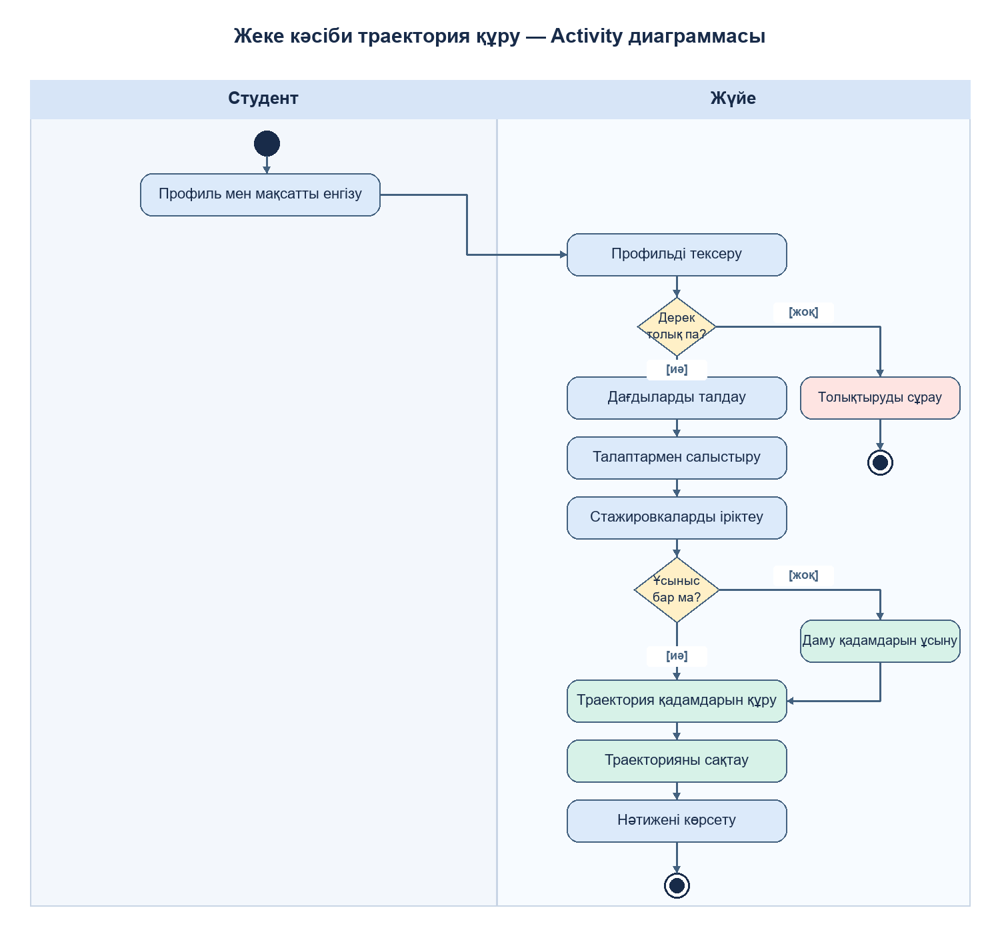
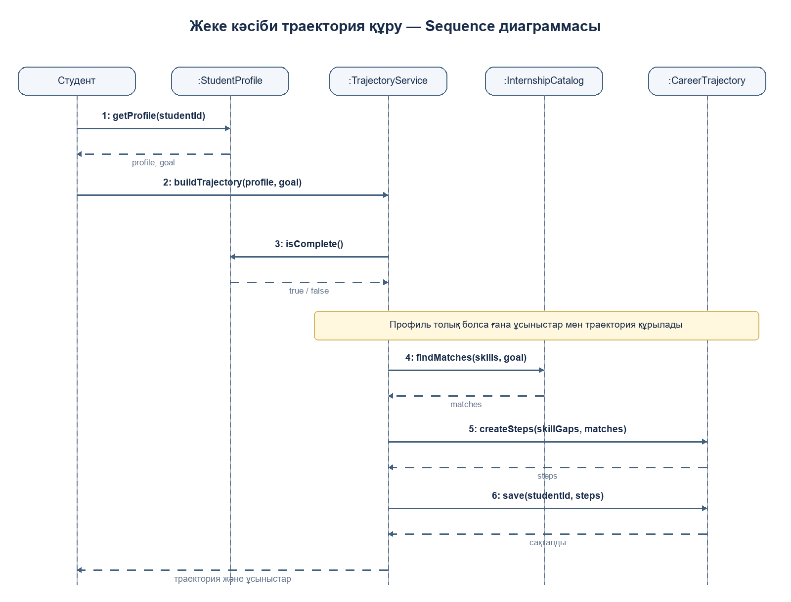

# Студенттерге стажировка табуға және жеке кәсіби траектория құруға арналған интеллектті веб-платформа

**Автор:** Абдразаков Алихан, ВТ(КИ)к-24-1а  
**Пән:** Бағдарламалық қосымшаларды талдау және жобалау

## Мәселе

Студентке өз дағдылары мен мақсатына сәйкес стажировканы табу және қай қабілетін дамыту керегін анықтау қиын. Вакансиялар әр жерде жарияланады, ал талаптар жеке профильмен қолмен салыстырылады. Жоспарланған веб-платформа студент профилін талдап, лайық стажировкаларды және кәсіби даму қадамдарын ұсынады.

## Акторлар

- **Студент** — дағдыларын, қызығушылықтарын және мансаптық мақсатын енгізіп, ұсыныстар мен жеке траекторияны қарайды.
- **Жұмыс беруші** — стажировка туралы мәлімет пен талаптарды жариялайды және жаңартады.
- **Мансап кеңесшісі** — ұсынылған даму қадамдарын қарап, студентке кеңес береді.

## Талаптар

### Функционалдық

1. Студент профильге дағдыларын, қызығушылықтарын, білімін және мансаптық мақсатын енгізе алады.
2. Жүйе траектория құруға қажет профиль деректерінің толықтығын тексереді.
3. Жұмыс беруші стажировка сипаттамасын және қажетті дағдыларды жариялай алады.
4. Жүйе студент профилін стажировка талаптарымен салыстырып, сәйкес ұсыныстарды көрсетеді.
5. Жүйе жетіспейтін дағдыларды анықтап, жеке кәсіби даму қадамдарын құрады.
6. Жүйе траекторияны сақтап, студентке қайта қарауға мүмкіндік береді.
7. Мансап кеңесшісі студент рұқсатымен траекторияны қарап, кеңес бере алады.

### Функционалдық емес

1. Студенттің жеке деректері рөлге негізделген қолжетімділікпен қорғалуы тиіс.
2. Ұсыныстың себебі түсінікті болуы тиіс: сәйкес дағдылар мен жетіспейтін талаптар көрсетіледі.
3. Негізгі әрекеттер телефон және компьютер экранында орындалуы тиіс.

Бұл — болашақ жүйеге арналған жобалау талаптары. Репозиторийде әзірге жұмыс істейтін веб-қосымша жоқ.

## Диаграммалар

Өңделетін `.drawio` файлдары мен README-де көрсетілетін `.png` суреттері [`docs/diagrams`](docs/diagrams) қалтасында.

### 1. Use Case

Диплом тақырыбына арналған Use Case диаграммасы кейін қосылады.

### 2. Class

Диплом тақырыбына арналған Class диаграммасы кейін қосылады.

### 3. Activity: жеке кәсіби траектория құру

Алғышарт: студент жүйеге кірген. Студент профильге дағдылары мен мақсатын енгізеді. Жүйе деректің толықтығын тексеріп, дағдыларды стажировка талаптарымен салыстырады, сәйкес ұсыныстарды және даму қадамдарын құрады. Сәйкес стажировка табылмаса да, даму қадамдары ұсынылады.



### 4. Sequence: жеке кәсіби траектория құру

Бұл диаграмма сол прецедентті сипаттайды. Нысандар: `:StudentProfile`, `:TrajectoryService`, `:InternshipCatalog`, `:CareerTrajectory`. Тұтас көрсеткі — әдіс шақыруы, пунктир көрсеткі — жауап. Әдістер мен параметрлер нөмірленіп жазылған.



## Әдістердің жобалық мағынасы

| Класс | Әдіс | Міндеті |
| --- | --- | --- |
| `StudentProfile` | `getProfile(studentId)` | Студент профилі мен мақсатын алу |
| `StudentProfile` | `isComplete()` | Міндетті деректердің толықтығын тексеру |
| `TrajectoryService` | `buildTrajectory(profile, goal)` | Жеке траектория құру процесін бастау |
| `InternshipCatalog` | `findMatches(skills, goal)` | Дағдылар мен мақсатқа сәйкес стажировкаларды табу |
| `CareerTrajectory` | `createSteps(skillGaps, matches)` | Жетпейтін дағдыларға сүйеніп даму қадамдарын құру |
| `CareerTrajectory` | `save(studentId, steps)` | Құрылған траекторияны сақтау |

## Құрылым

```text
README.md
docs/diagrams/
  03-activity.drawio
  03-activity.png
  04-sequence.drawio
  04-sequence.png
src/  (кейінгі бағдарлама коды)
```
